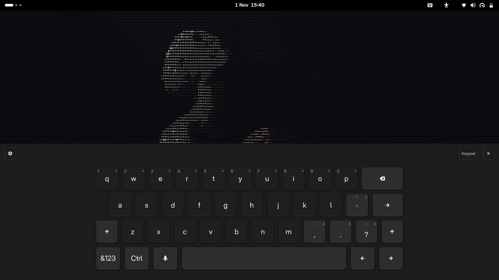

# lvOSK

A vibecoded on-screen keyboard for GNOME Shell, created to make Linux life easier.

## Screenshots




## Features

- Windows 11-style 4-row layout with proper key sizing and gaps
- Bigger keys, bigger bottom margin, darker alphabet keys
- Character callout above the pressed key
- Alternate-key hints with long-press to type the secondary character
- Phone-style numeric keypad that slides in from the right
- Noticeably lighter pressed-key color
- macOS-style soft key click sound
- Settings menu: key size (Compact / Default / Large), sound feedback, auto-show on text focus, numpad by default; follows system light/dark theme
- Touch-triggered pill button in the GNOME top panel (hidden until you touch the screen)
- Compact mode by default
- Input preview bubble above the keyboard
- Auto-show on text focus in GTK apps; touch detection works in Chrome and other apps
- Hot-reloadable (no need to restart GNOME Shell after edits)
- Persists settings to `~/.config/lvosk/settings.json`

## Requirements

- GNOME Shell 45-51
- Wayland session
- Touchscreen (recommended) or mouse

## Install

```bash
git clone git@github.com:lvddr/lvOSK.git
cd lvOSK
./install.sh
gnome-extensions enable win11-osk@local
```

### Install from a release
Download the source archive from the [latest release](https://github.com/lvddr/lvOSK/releases/latest), extract it, then:
```bash
cd lvOSK-*
./install.sh
gnome-extensions enable win11-osk@local
```

Then log out and back in (or restart GNOME Shell) so the extension is discovered.

## Usage

- **Toggle keyboard:** click the yellow pill in the center of the top panel (appears on touch).
- **Settings:** click the gear icon on the keyboard header.
- **Numeric keypad:** click the grid icon to slide in the numpad.
- **Dock/float:** click the minimize icon to toggle floating mode.
- **Close:** click the X icon.

## Settings

Settings are stored in `~/.config/lvosk/settings.json`:

```json
{
  "keySize": "compact",
  "sound": true,
  "autoShow": false,
  "numpadByDefault": false
}
```

## Development

Source files live in `src/`. The build bundles them into `main.js` at the project root.

```bash
./build.sh          # bundle src/* into main.js
./install.sh        # copy runtime files to installed location
gnome-extensions disable win11-osk@local
gnome-extensions enable win11-osk@local   # hot reload
```

## License

MIT
